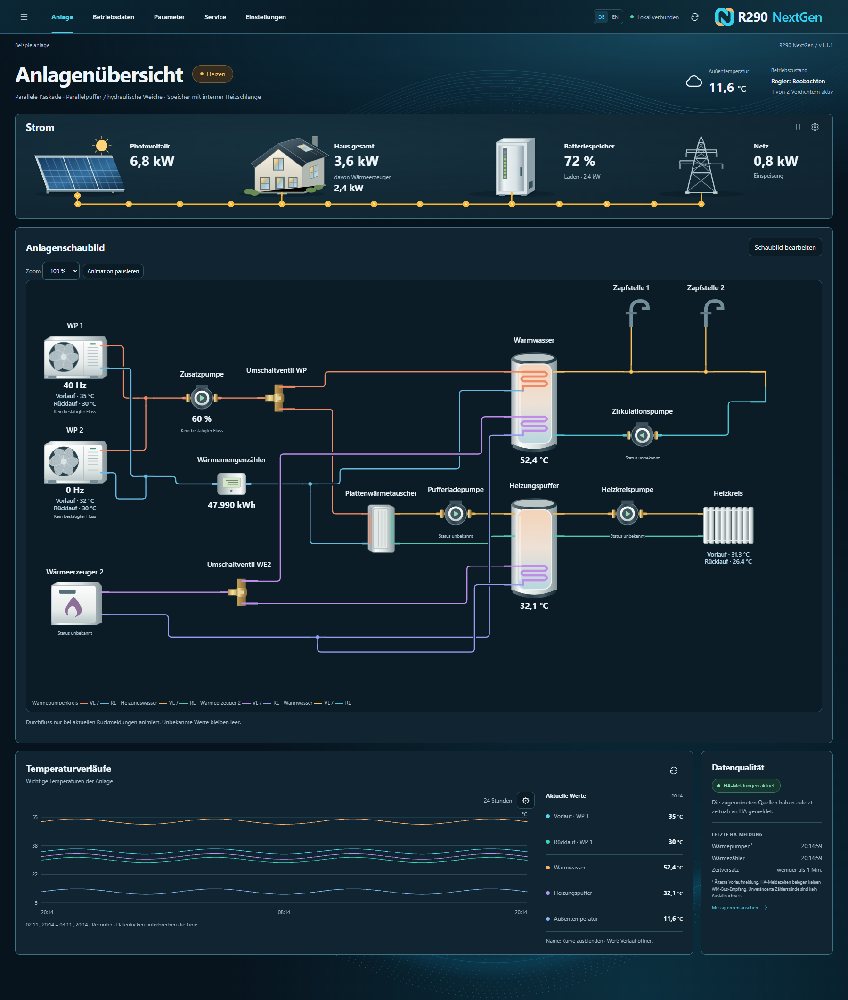
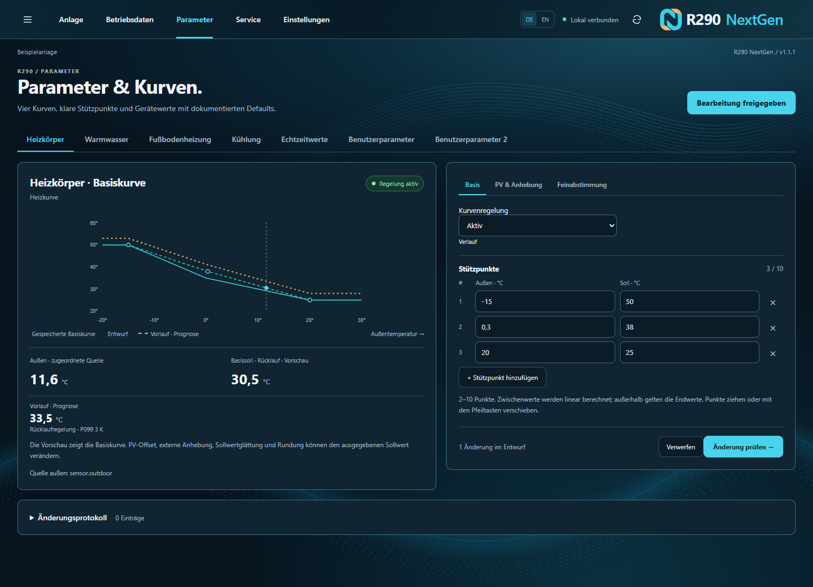
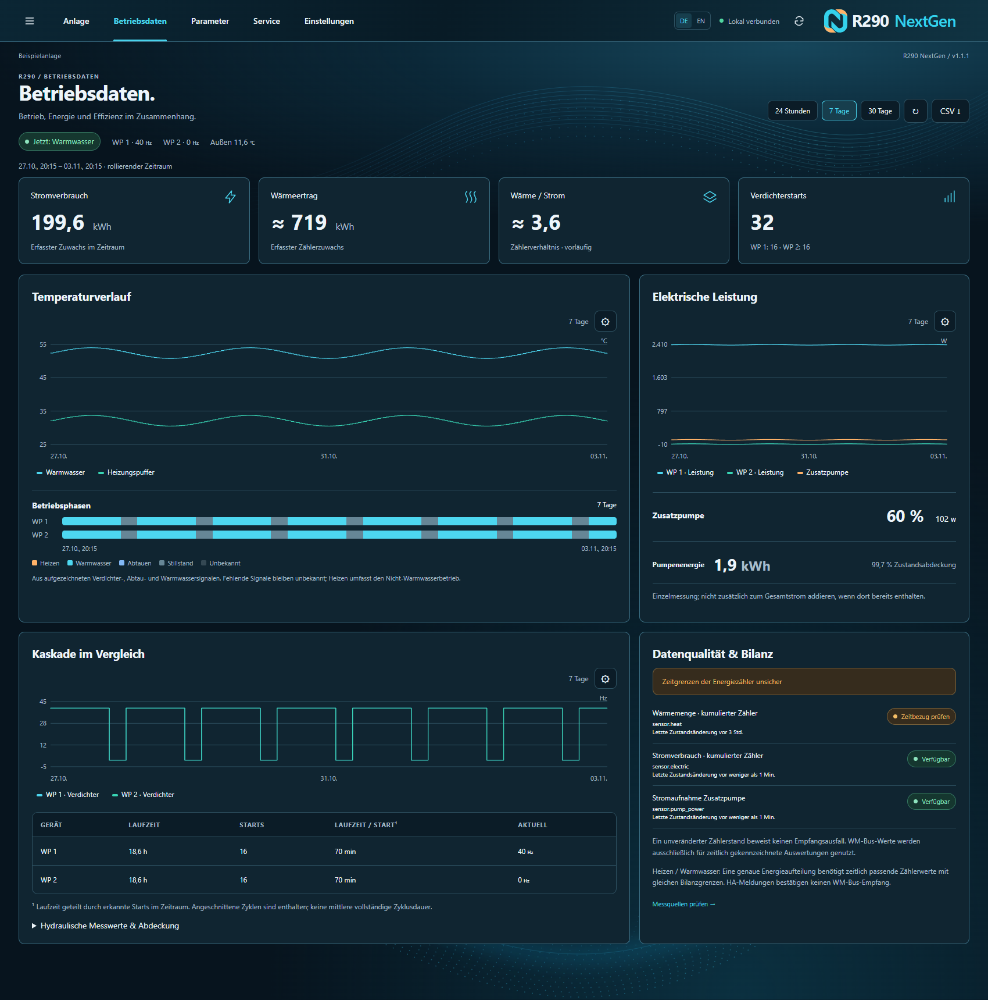

# R290 NextGen für Home Assistant

**Deine Wärmepumpe im Blick – von der Anlagenübersicht bis zur Heizkurve.**

R290 NextGen verbindet kompatible R290-Wärmepumpen über Modbus mit Home Assistant. Die Integration zeigt Temperaturen, Betriebszustände und Verläufe in einer eigenen Oberfläche und unterstützt dich dabei, Heiz- und Kühlkurven sowie Geräteparameter zu verstehen und gezielt anzupassen. Die Kommunikation erfolgt lokal.

*Anlagenübersicht mit Energieströmen, Wärmepumpen und Hydraulikschema. Die Screenshots zeigen eine Beispielanlage mit Testdaten.*

## Was bietet R290 NextGen?

- **Alles auf einen Blick:** Anlagenzustand, Vor- und Rücklauf, Warmwasser, Pufferspeicher und wichtige Temperaturverläufe.
- **Heiz- und Kühlkurven:** Kurven mit zwei bis zehn Stützpunkten bearbeiten und Änderungen vor dem Speichern prüfen. Die Darstellung ergänzt eine Vor- oder Rücklaufprognose anhand der Regelungsart und der Zielspreizung P099.
- **Individuelles Anlagenschaubild:** Wärmepumpen, Speicher, Ventile und weitere Komponenten passend zur eigenen Hydraulik anordnen und mit Home-Assistant-Entitäten verbinden.
- **Betriebsdaten und Diagnose:** Messwerte, Verdichterzustände und Verläufe betrachten sowie Geräteparameter und verfügbare Fehlerdaten einsehen.
- **Energie im Zusammenhang:** PV-Erzeugung, Hausverbrauch, Batteriespeicher, Netz und Wärmeerzeuger visualisieren, sofern passende Sensoren vorhanden sind.
- **Mehrere Geräte:** Wärmepumpen und weitere Modbus-Einträge teilen sich eine Bridge und eine koordinierte Verbindung.
- **Für unterschiedliche Anlagen:** Optionale Zusatzpumpenregelung, weitere Wärmeerzeuger sowie eigene Sensorzuordnungen. Neue Regelungen starten im Beobachtungsmodus.
- **Deutsch und Englisch:** Oberfläche für Desktop und Mobilgeräte.

*Heizkurve mit editierbaren Stützpunkten und prognostizierter Vorlauftemperatur.*

*Betriebsdaten und Verläufe der Beispielanlage.*

## Voraussetzungen

- Home Assistant mit der Möglichkeit, benutzerdefinierte Integrationen zu installieren.
- Eine R290-Wärmepumpe mit einem zur Integration passenden Modbus-Registersatz und ein erreichbares Modbus-Gateway. Unterstützt werden RTU über TCP, Modbus TCP und ModbusProxy. Die konkreten Register und Funktionen hängen vom Gerät und seiner Firmware ab.
- Für Energieflüsse, Verläufe und optionale Regelungen werden die jeweiligen Sensoren und Aktoren benötigt.

## Installation und Update

### Über HACS

1. In HACS unter **Integrationen → Benutzerdefinierte Repositories** `https://github.com/CNC-Buddy/R290_heatpump` als Integration hinzufügen.
2. **R290 NextGen** installieren oder aktualisieren und Home Assistant neu starten.
3. Die Integration unter **Einstellungen → Geräte & Dienste** hinzufügen beziehungsweise vorhandene Einträge weiterverwenden.

Version v1.1.1 muss zuerst in diesem Repository veröffentlicht werden, bevor sie dort über HACS verfügbar ist.

### Manuell

1. Die Home-Assistant-Konfiguration und bei einem Update den bisherigen Integrationsordner sichern.
2. Das Release-Quellarchiv entpacken und den enthaltenen Ordner `custom_components/r290_heatpump` in das gleichnamige Verzeichnis unter der Home-Assistant-Konfiguration kopieren. Den bestehenden Integrationsordner vollständig ersetzen.
3. Home Assistant neu starten. Die Oberfläche zeigt **v1.1.1**.

Die Domain `r290_heatpump` bleibt erhalten. Dies ist ein Update der Home-Assistant-Integration und keine Wärmepumpen-Firmware.

## Erste Schritte

1. Eine **Modbus-Bridge** mit der passenden Verbindungsart und Gateway-Adresse einrichten.
2. Wärmepumpe(n) und die benötigten Heiz-, Kühl- oder Warmwasserkurven als Integrationseinträge hinzufügen.
3. Im Bereich **Einstellungen** die verfügbaren Sensoren zuordnen und das Anlagenschaubild an die eigene Hydraulik anpassen.
4. Bei Bedarf in den Optionen der ersten Bridge das R290-Panel und das Lovelace-Dashboard getrennt in der Seitenleiste anzeigen oder ausblenden. Das Ausblenden erhält das Dashboard-Layout; die separate Aktion zum Neuerstellen ersetzt es durch die Vorlage.

Parameteränderungen und aktive Regelungen müssen zur eigenen Anlage passen. Vor der Freigabe einer Zusatzpumpenregelung insbesondere Hydraulik, Signalzuordnung und Betriebsgrenzen prüfen.

## Dokumentation und Rückmeldung

- [Einrichtung, Oberfläche und Architektur](docs/nextgen.md)
- [Zusatzpumpenregelung und Diagnose](docs/auxiliary-pump.md)
- [Lokale Validierung und Tests](docs/validation.md)
- [Fehler melden oder Anregungen teilen](https://github.com/CNC-Buddy/R290_heatpump/issues)

Bei einer Fehlermeldung helfen Modell, Firmware, Gateway und eine Beschreibung des Verhaltens. Zugangsdaten und private Adressen bitte entfernen. Die Lizenzbedingungen stehen in [license.txt](license.txt).

---

## English

**R290 NextGen is a local Home Assistant integration for compatible Modbus-connected R290 heat pumps.** Monitor temperatures and operating states, explore historical data, build a hydraulic overview and adjust heating or cooling curves. The interface is available in English and German. Features depend on the device, firmware and available Home Assistant entities.

Install the integration through HACS using this repository as a custom integration, or copy `custom_components/r290_heatpump` from a release source archive into your Home Assistant configuration and restart. Version 1.1.1 becomes available through HACS after it is published. Existing integration entries use the same `r290_heatpump` domain. See the [documentation](docs/nextgen.md) and [license](license.txt) for details.
