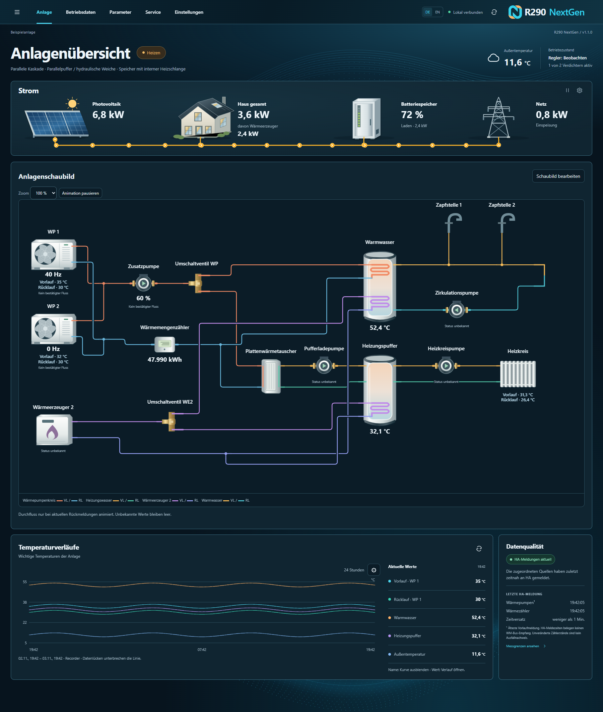
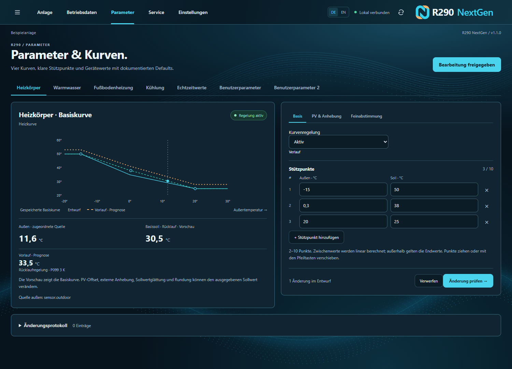

# R290 NextGen v1.1.0 – Wärmepumpen in Home Assistant im Blick

Mit Version 1.1.0 erhält die R290-Integration eine umfassend überarbeitete Oberfläche für die lokale Überwachung und Konfiguration kompatibler Wärmepumpen. Von Temperaturen und Betriebsdaten bis zu Heizkurve und Hydraulikschema: Die Informationen deiner Anlage sind an einem Ort erreichbar.

*Die Abbildungen zeigen eine Beispielanlage mit Testdaten.*

## Die wichtigsten Neuerungen

### Deine Anlage als übersichtliches Schaubild

Wärmepumpen, Speicher, Ventile, Pumpen und weitere Wärmeerzeuger lassen sich zu einem Anlagenschaubild zusammenstellen und mit Home-Assistant-Entitäten verbinden. Temperaturverläufe und Betriebszustände ergänzen die Übersicht.

### Heiz- und Kühlkurven besser verstehen

Kurven für Heizkörper, Fußbodenheizung, Kühlung und Warmwasser können mit zwei bis zehn Stützpunkten bearbeitet werden. Änderungen lassen sich vor dem Speichern prüfen. Bei Heiz- und Kühlkurven zeigt eine zusätzliche Prognose die erwartete Vor- beziehungsweise Rücklauftemperatur anhand der gewählten Regelungsart und der Zielspreizung P099.

### Betriebsdaten und Energie im Zusammenhang

Messwerte, Verdichterzustände und Verläufe helfen beim Einordnen des Betriebs. Passende Home-Assistant-Sensoren vorausgesetzt, zeigt die Oberfläche auch PV, Hausverbrauch, Batteriespeicher, Netz und Wärmeerzeuger.

### Mehr Flexibilität für deine Anlage

- Mehrere Wärmepumpen und Modbus-Einträge nutzen eine gemeinsame Bridge und koordinierte Kommunikation.
- Eine optionale Zusatzpumpenregelung und weitere Wärmeerzeuger können eingebunden werden. Neue Regelungen beginnen im Beobachtungsmodus.
- Das R290-Panel und das Lovelace-Dashboard lassen sich in den Bridge-Optionen getrennt in der Seitenleiste ein- oder ausblenden.
- Die Oberfläche unterstützt Deutsch und Englisch sowie Desktop und Mobilgeräte.

## Update und Installation

Die bestehende Integration kann über HACS aktualisiert werden, sobald das Release veröffentlicht ist. Bei manueller Installation den Ordner `custom_components/r290_heatpump` aus dem Release-Quellarchiv übernehmen und Home Assistant neu starten. Vorher die Konfiguration sichern.

Bestehende Einträge verwenden weiterhin die Domain `r290_heatpump`. Nach dem Neustart zeigt das Panel **v1.1.0**. Dies ist ein Update der Home-Assistant-Integration; die Firmware der Wärmepumpe wird nicht verändert. Funktionen und verfügbare Werte hängen vom Gerät, seiner Firmware und den eingebundenen Sensoren ab.

Die Version wurde lokal mit automatisierten Tests und Home-Assistant-Testdaten geprüft. Ein vollständiger Dauertest für alle Anlagenkonfigurationen wurde nicht durchgeführt. Hinweise und Fehlerberichte sind im [Issue-Bereich](https://github.com/CNC-Buddy/R290_heatpump/issues) willkommen.

---

## English

**R290 NextGen v1.1.0 brings a redesigned local Home Assistant experience to compatible Modbus-connected R290 heat pumps.** Explore your plant diagram, temperatures and operating history; edit heating and cooling curves; and connect available energy sensors. Separate sidebar controls let you choose which integration views to display.

Update through HACS after publication, or replace `custom_components/r290_heatpump` from the release source archive and restart Home Assistant. Existing entries retain the `r290_heatpump` domain. Features depend on the device, firmware and configured entities.
